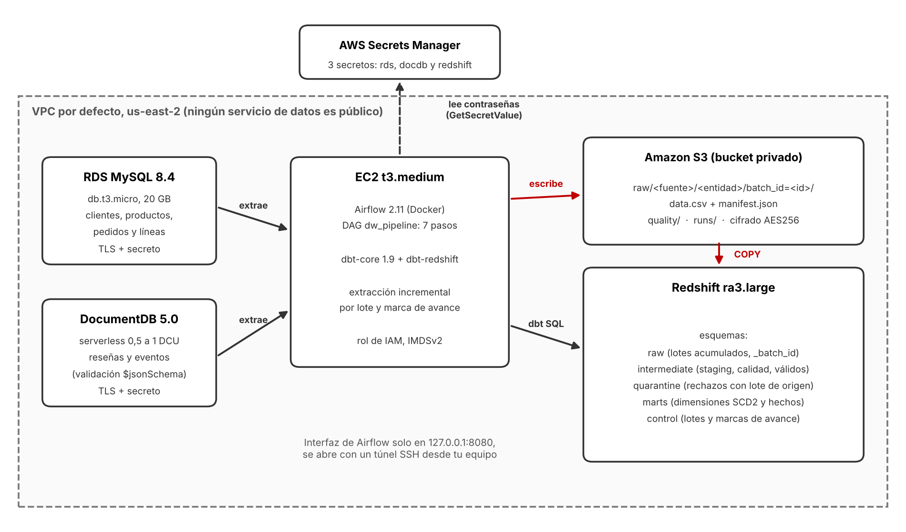

# Data warehouse de comercio electrónico en AWS

Migración a AWS de un data warehouse local (MySQL, MongoDB, DuckDB, dbt y Airflow en Docker). Las fuentes pasan a **RDS MySQL** y **DocumentDB**, los lotes se guardan en **S3**, el almacén es **Redshift**, y **Airflow con dbt** corre en una EC2. Hay extracción inicial e incremental por lote, calidad con cuarentena, historial SCD tipo 2 y recuperación ante fallos.



## Estado

Proyecto terminado y probado de punta a punta en AWS. **Los recursos ya fueron eliminados** (verificación en `evidencias/eliminacion_dw_verificada.txt`), por lo que no genera costos. Se puede volver a desplegar desde cero con [docs/instrucciones.md](docs/instrucciones.md).

QuickSight quedó fuera del alcance por indicación del profesor: el consumo se demuestra con consultas SQL sobre el modelo analítico y la conciliación de un indicador.

## Resultados

- **Carga inicial:** 253 ventas, 150 reseñas y 500 eventos de navegación, con ventas por 7.293.790,26; los mismos números de la versión local.
- **Calidad:** 16 motivos de rechazo en cuarentena, cada uno con su lote de origen.
- **Pruebas:** 92 pruebas de dbt en verde en Redshift, más la conciliación del modelo con el origen válido.
- **Escenarios:** los siete validados (carga inicial, registros defectuosos, repetición de un lote, lote incremental, cambio SCD2 y dos fallos controlados), cada uno con su evidencia.
- **Costo estimado del laboratorio:** unos USD 2 (ver [docs/costos_seguridad.md](docs/costos_seguridad.md)).

## El DAG `dw_pipeline` (7 pasos)

Validar conexiones y parámetros, extraer (MySQL y DocumentDB en paralelo), escribir en S3, cargar en Redshift con `COPY`, transformar con dbt, pruebas de calidad y conciliación, y registrar el resultado. Tiene reintentos acotados, una sola ejecución activa y parámetros para reprocesar un lote desde S3 y para provocar un fallo controlado.

## Estructura del repositorio

| Ruta | Contenido |
|---|---|
| `src/airflow/dags/dw_pipeline.py` | DAG de los 7 pasos |
| `src/ecommerce_dw/pipeline.py` | Lógica de cada paso (probable sin Airflow) |
| `src/ecommerce_dw/ingestion/` | Extracción incremental, escritura de lotes en S3, `COPY` a Redshift y tablas de control |
| `src/ecommerce_dw/aws/` | Conexiones con TLS y secretos de Secrets Manager |
| `src/ecommerce_dw/sources/` | Generación de datos, lotes y cambios para RDS y DocumentDB |
| `src/dbt/` | Modelos, snapshots SCD2, pruebas y macros; corre en Redshift y en DuckDB (pruebas locales) |
| `docker/` | Imagen de Airflow con dbt-redshift y `docker-compose`, sin secretos |
| `infra/` | Despliegue (`desplegar_dw.py`), Airflow en la EC2, ejecución, escenarios, evidencias, pausa y eliminación (`destruir_dw.py`) |
| `tests/` | Pruebas de punta a punta y de despliegue, sin AWS |
| `docs/` | Documentación (la versión local original está en `docs/local_original/`) |
| `evidencias/` | `dw/` (evidencias generales), `escenarios_dw/` (escenarios) y la verificación de eliminación |

## Documentación

| Documento | Contenido |
|---|---|
| [arquitectura_aws.md](docs/arquitectura_aws.md) | Diagrama, componentes, capas de Redshift y el DAG |
| [lotes_incrementalidad.md](docs/lotes_incrementalidad.md) | Cómo se identifica un lote, cuándo avanza la marca de avance, reproceso y recuperación |
| [decisiones_tecnicas.md](docs/decisiones_tecnicas.md) | Diferencias frente a lo local, ajustes de SQL para Redshift y MongoDB frente a DocumentDB |
| [calidad_y_pruebas.md](docs/calidad_y_pruebas.md) | Reglas de calidad, pruebas y escenarios |
| [instrucciones.md](docs/instrucciones.md) | Despliegue, ejecución, pausa y eliminación, paso a paso |
| [costos_seguridad.md](docs/costos_seguridad.md) | Estimación de costos y controles de seguridad |
| [demostracion_documentada.md](docs/demostracion_documentada.md) | La demostración, por escrito, con extractos reales de las evidencias |
| [guion_demostracion_dw.md](docs/guion_demostracion_dw.md) | Guion con los comandos para repetirla |

## Evidencias

| Qué demuestra | Archivo |
|---|---|
| Ejecución exitosa del pipeline en Airflow | `evidencias/dw/airflow_evidencia.txt` |
| Resultados de las pruebas de dbt | `evidencias/dw/dbt_evidencia.txt` |
| Consulta SQL que verifica el indicador (ventas y líneas por mes) | `evidencias/dw/indicador_ventas.txt` |
| Lotes, marcas de avance, hechos, dimensiones y cuarentena en Redshift | `evidencias/dw/redshift_estado.txt` |
| Estructura de lotes en S3 y un manifiesto | `evidencias/dw/s3_evidencia.txt` |
| Controles de seguridad | `evidencias/dw/seguridad_evidencia.txt` |
| Los siete escenarios | `evidencias/escenarios_dw/` |
| Infraestructura eliminada | `evidencias/eliminacion_dw_verificada.txt` |

## Diferencias con la versión local

| Local | AWS |
|---|---|
| MySQL y MongoDB en contenedores | RDS MySQL y DocumentDB, con TLS y contraseñas en Secrets Manager |
| `raw` se reemplazaba en cada corrida | `raw` acumula lotes (`_batch_id`); staging toma la última versión de cada llave |
| Extraía las tablas completas | Extracción inicial y luego incremental por marca de avance, con ventana de 7 días |
| CSV en una carpeta local | S3 por lote, con manifiesto; nunca se sobrescribe un lote |
| DuckDB | Redshift aprovisionado; el esquema `raw` va entre comillas porque `RAW` es palabra reservada |
| 3 DAGs | 1 DAG de 7 pasos |

## Prueba local, sin AWS

```bash
pip install dbt-core==1.9.4 dbt-duckdb==1.9.4 duckdb mongomock "moto[ec2,rds,redshift,secretsmanager,iam,s3,ssm,sts]" Faker PyMySQL pymongo boto3
python tests/test_pipeline_local.py    # pipeline completo con fuentes y S3 simulados (unos 4 minutos)
python tests/test_despliegue.py        # despliegue y destrucción contra AWS simulado
```
