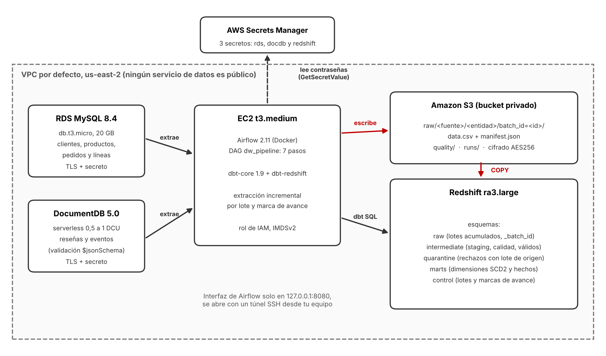

# Arquitectura del data warehouse en AWS

## Componentes (región us-east-2, VPC por defecto)

| Componente | Configuración | Función |
|---|---|---|
| RDS MySQL | 8.4, `db.t3.micro`, 20 GB gp3, cifrado, sin acceso público | Fuente relacional: clientes, productos, pedidos y líneas |
| DocumentDB | 5.0, serverless de 0,5 a 1 DCU, cifrado, sin acceso público | Fuente documental: reseñas y eventos de navegación, con validación `$jsonSchema` |
| EC2 | `t3.medium` (Amazon Linux 2023), disco gp3 de 30 GB cifrado, IMDSv2 obligatorio | Ejecuta Airflow y dbt |
| Apache Airflow | 2.11.2 en Docker Compose, LocalExecutor y Postgres propio para sus metadatos | Orquesta el DAG `dw_pipeline` |
| dbt | dbt-core 1.9.4 y dbt-redshift 1.9.5, en un entorno virtual aparte | Transformaciones, snapshots SCD2 y pruebas |
| S3 | Un bucket privado, cifrado AES256, bloqueo total de acceso público | Archivos de cada lote, informes de conciliación y estado de cada ejecución |
| Redshift | Aprovisionado, `ra3.large` de un nodo, cifrado, sin acceso público | Almacén analítico |
| Secrets Manager | Tres secretos: `taller-dw/rds`, `taller-dw/docdb`, `taller-dw/redshift` | Usuario y contraseña de cada base, generados al azar |
| IAM | `taller-dw-ec2-role` (S3 del bucket y lectura de los tres secretos) y `taller-dw-redshift-role` (leer `raw/` del bucket) | Permisos mínimos, sin claves de acceso en ninguna máquina |

Un grupo de seguridad deja entrar por SSH solo desde una IP (/32); otro permite los puertos 3306, 27017 y 5439 **únicamente desde la EC2**. La interfaz de Airflow escucha solo en `127.0.0.1:8080` y se abre con un túnel SSH.

## Capas de Redshift

| Esquema | Contenido | Quién lo escribe |
|---|---|---|
| `raw` | Una fila por registro y por lote extraído; acumula los lotes. Columnas de control: `_batch_id`, `_loaded_at`, `_source`. Va entre comillas porque `RAW` es palabra reservada | `COPY` desde S3 |
| `intermediate` | Staging (última versión de cada llave), calidad (`*__qa`, con `rejection_reason`) y válidos (`*__valid`), y los snapshots SCD2 | dbt |
| `quarantine` | Registros rechazados, con su motivo y el lote de origen (`_batch_id`) | dbt |
| `marts` | Dimensiones (`dim_customer` y `dim_product` con SCD2; `dim_date`, `dim_geography`, `dim_sales_channel`, `dim_event_type`) y hechos (`fct_sales`, `fct_reviews`, `fct_navigation_events`) | dbt |
| `control` | `batches` (estado de cada lote), `batch_entities` (filas por entidad y lote) y `watermarks` (marcas de avance) | El pipeline |

## DAG `dw_pipeline`

13 tareas en los 7 pasos del enunciado, con dependencias explícitas, 2 reintentos (espera de 1 minuto, creciente hasta 10) y `max_active_runs = 1`. Cada línea de registro lleva `[lote=...] [tarea=...]`.

| Paso | Tarea(s) | Qué hace |
|---|---|---|
| 1 | `1_validar_conexiones_y_parametros` | Verifica variables, RDS, DocumentDB, S3 y Redshift; crea las tablas de control; decide el modo (nueva extracción o reproceso) y registra el lote |
| 2 | `2_extraer_mysql`, `2_extraer_mongodb` | Extracción inicial o incremental por marca de avance; corren en paralelo |
| 3 | `3_escribir_s3` | Sube cada entidad con su manifiesto, sin sobrescribir lotes |
| 4 | `4_cargar_redshift` | `COPY` a una tabla temporal, verificación de conteos y reemplazo de las filas del lote en `raw` |
| 5 | `5_dbt_deps`, `5_dbt_seed`, `5_dbt_intermediate`, `5_dbt_quarantine`, `5_dbt_snapshot`, `5_dbt_marts` | Transformaciones y snapshots |
| 6 | `6_pruebas_calidad` | `dbt test` más la conciliación del modelo con el origen válido (guarda el informe en S3) |
| 7 | `7_registrar_resultado` | Corre siempre. Con éxito: el lote queda `COMPLETO` y avanzan las marcas de avance. Si algo falló: `FALLIDO` |

Parámetros del DAG: `reprocess_batch_id` (reprocesa un lote desde S3 sin consultar las fuentes) y `simular_fallo` (solo para demostraciones: provoca un fallo controlado que se recupera en el reintento).

## Consumo

QuickSight no forma parte del alcance, por indicación del profesor. El consumo se demuestra con consultas SQL sobre `marts` y con la conciliación de un indicador agregado (`evidencias/dw/indicador_ventas.txt`).
